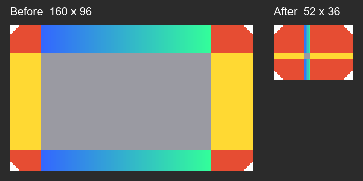

# 9-Slice Optimizer

A Unity editor tool that shrinks a 9-sliced sprite's stretch zones to a few pixels, keeping its corners and border. A 9-slice renderer stretches the middle column and the middle row anyway, so the pixels in those zones only matter as an average: the tool averages them down and the sprite looks exactly the same on screen, from a much smaller texture.

Example: a 497 × 71 button body with 63 px left and 61 px right borders becomes 128 × 71. Same look, a quarter of the pixels.



The package itself is in [`Packages/com.dyskotron.nineslice-optimizer`](Packages/com.dyskotron.nineslice-optimizer); the rest of this repository is the Unity project it is developed and tested in.

## Install

Requires Unity 2021.3 or newer.

1. In Unity open **Window › Package Manager**.
2. Click the **+** button in the top-left corner and choose **Install package from git URL…** (older versions: *Add package from git URL…*).
3. Paste this URL and click **Install**:

   ```
   https://github.com/dyskotron/9SliceOptimizer.git?path=Packages/com.dyskotron.nineslice-optimizer#v1.0.0
   ```

4. Wait for the import. **9-Slice Optimizer** now appears in the Package Manager's *In Project* list, and *Tools › UI › 9-Slice Optimizer* in the menu.

Alternatively add the dependency to `Packages/manifest.json` by hand:

```json
{
  "dependencies": {
    "com.dyskotron.nineslice-optimizer": "https://github.com/dyskotron/9SliceOptimizer.git?path=Packages/com.dyskotron.nineslice-optimizer#v1.0.0"
  }
}
```

Drop the `#v1.0.0` to follow the latest commit instead of a release. Git must be installed on the machine for Unity to fetch a git package.

## Use

1. **Set the sprite's 9-slice border.** Select the texture, make sure its *Texture Type* is **Sprite (2D and UI)**, click **Sprite Editor**, and drag the green border lines (or type *Border* L / R / T / B) so the corners and edges you want kept lie outside them. Click **Apply**. The tool reads these values; it has nothing to work with without them.
   - A button that only stretches sideways needs only left and right borders. Leave top and bottom at 0: the height is then kept as it is.
2. **Open the tool.** Right-click the texture (or the sprite under it) in the Project window and choose **9-Slice › Optimize 9-Slice…**. (Or *Tools › UI › 9-Slice Optimizer* and drop the texture into its *Sprite / Texture* field.)
3. **Check the preview.** The top image is your sprite with its 9-slice lines; the bottom one is the result at the current settings, with its size and the share of pixels it keeps.
4. **Choose how much to keep.** *Center Width* and *Center Height* are how many pixels the stretched column and row keep (they size the top/bottom and left/right edges too). 2 to 4 px is plenty for a flat or softly graded middle; a zone is never grown. The *Border* fold shows the values read from the sprite and lets you try others without touching the sprite.
5. **Write the result.**
   - **Save As New…** writes a new PNG next to the source (`{name}_9s.png` is suggested) as a Single sprite with the same border, pivot and import settings. Point your Image components at it.
   - **Replace Source** overwrites the source PNG in place and sets its border, so every Image, prefab and scene that already uses the sprite keeps working. It needs a PNG with one sprite and asks for confirmation; use version control, it can't be undone.
6. Done. The sprite renders as before in any *Sliced* or *Tiled* Image, and in UI Toolkit's slice mode.

### Good to know

- Only the stretch zones change; corners are copied pixel for pixel.
- Detail *along* a stretch direction is averaged away (it would have been smeared by stretching anyway); a gradient *across* an edge survives.
- No border on an axis means that axis is not sliced and is kept whole. No border at all means nothing is shrunk.
- Pixels are read from the PNG/JPG file itself, so the import's compression and Max Size don't matter. Other formats fall back to the imported texture.
- A sprite sheet (Multiple mode) with several sprites: the chosen sprite is cropped out and saved as a new Single sprite; Replace Source is disabled for it.

## Developing

Open this repository as a Unity project (6000.x). The package is a local `file:` dependency, so edits in `Packages/com.dyskotron.nineslice-optimizer` apply directly. The EditMode tests show in the Test Runner (the package is listed under `testables`). `Assets/Samples/Fixture_Panel.png` is a 160 × 96 sprite with a 20 / 14 / 28 / 18 border to try the tool on.

## License

MIT
